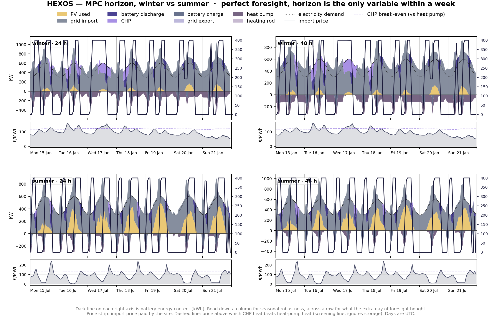
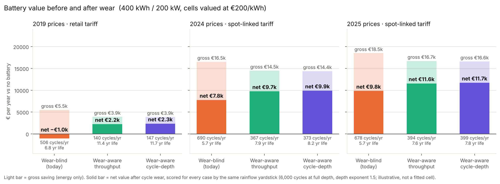
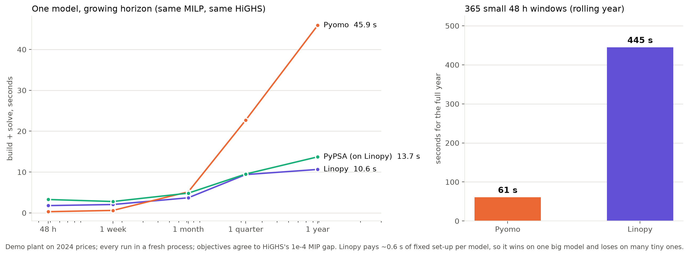

# HEXOS — Multi-Energy Dispatch Optimizer

HEXOS works out the cheapest way to run an industrial site's energy system,
hour by hour. A factory or campus with its own solar, combined heat-and-power
(CHP) units, heat pumps, boilers, and batteries has to decide constantly where
its electricity and heat should come from — and doing that well, against
changing prices and weather, can save real money. HEXOS makes that decision
automatically by solving it as an optimization problem instead of following
fixed rules.

Under the hood it's a Mixed-Integer Linear Program, written in Python with
[Pyomo](https://pyomo.org) and solved using [HiGHS](https://highs.dev). Most of
the model is linear, but the CHP on/off choices are yes/no decisions — that's
the "integer" part — along with realistic constraints like minimum runtime,
ramp limits, and start-up costs. The same model also runs on
[Linopy](https://github.com/PyPSA/linopy) and, for the core site, as a
[PyPSA](https://pypsa.org) network; all three reach the same optimum.

## What it does

- Optimizes a full year (8,757 hours) with a rolling-horizon solver: 365
  overlapping 48 h windows, 24 h committed each, with battery, heat-store and
  CHP state carried across windows. The whole year solves in about a minute.

- Runs on real data: German day-ahead electricity prices (OPSD for 2019,
  Energy-Charts and SMARD for 2024 onwards), Munich weather (EnergyPlus), and
  heat-demand and heat-pump efficiency profiles (When2Heat).

- Includes a closed-loop Model Predictive Control simulation that tests how the
  system performs when it has to rely on imperfect forecasts. With hourly re-planning,
  that uncertainty costs under 0.1% against a perfect-foresight benchmark on the 2019 data.

- Quantifies the euro value of battery flexibility through a controlled
  full-year experiment that toggles only the battery, holding everything else
  fixed — isolating ~€5,500/yr on 2019 prices (about 1.3% of annual operating
  cost) and €16.5k/yr on 2024 prices with a spot-linked tariff, both before
  battery wear. Left in its own self-consumption mode the battery saves
  nothing at this site, because solar never exceeds the site's load.

- Forecasts day-ahead prices probabilistically (P10/P50/P90) with a
  walk-forward backtest, and calibrates the prediction intervals using conformal
  prediction so the 80% band actually holds ~80% coverage (79.6% out-of-sample,
  up from 59.4% raw).

- Runs a study on how much the heat pump's efficiency modelling actually affects
  the results — a small but real modelling-fidelity question.

- Turns the optimiser into a price-responsive day-ahead bidder for the site's
  own demand: stepwise bid curves built by parametric solves over the P10–P90
  price band, made monotone with isotonic regression, and settled against
  realised 2019 German day-ahead prices next to a committed-volume baseline and
  a perfect-foresight yardstick. HEXOS stays a price-taker here; it is demand-
  side bidding, not a trading strategy.

- Tests whether one day of MPC foresight is enough by running 24 h and 48 h
  horizons over four seasonal weeks with perfect forecasts, so horizon length
  is the only thing that changes. The result is reported as a range across
  seasons rather than a single week.

- Comes with an interactive dashboard (Streamlit + Plotly) where you can pick a
  real day, switch technologies on and off, and solve it live. Results are saved
  to a PostgreSQL database so you can compare past runs.

- Prices battery wear into dispatch, so the battery only cycles when the
  spread also pays for the capacity it uses up (see below).

- Keeps its open data current with a daily, self-checking data feed (see below).

- Backed by a 134-test pytest suite, run by GitHub Actions on every push,
  covering storage continuity, constraint satisfaction, energy-balance
  invariants, MPC behaviour, the bidding layer (monotone curves, settlement,
  ordering against perfect foresight), the wear models and rainflow counter,
  backend parity, and the data-feed parsers.

## Getting started

```bash
python -m venv .venv && source .venv/bin/activate   # Windows: .venv\Scripts\activate
pip install -r requirements.txt
pip install linopy pypsa psutil                     # optional: Linopy / PyPSA back-ends, benchmark memory on Windows
pytest -q                                           # 134 passing (Linopy/PyPSA tests skip if not installed)
streamlit run app/streamlit_app.py                  # launch the dashboard
```

The full-year scenarios need the raw datasets — `data/raw/README_DOWNLOAD.md`
explains where to get them. The database features are optional; the app runs
fine without one, and `SETUP_DATABASE.md` covers the setup if you want them.

## One week, two seasons, two horizons



One winter and one summer week of 2024 day-ahead prices (Energy-Charts), each
solved with a 24 h and a 48 h MPC horizon under perfect foresight. Sources of
electricity stack above zero, sinks other than demand below it, and the dark
line is battery energy content. The strip under each panel is the import price
with the CHP break-even price. Reproduce with:

```bash
python scenarios/run_horizon_sweep.py --data 2024
python scenarios/plot_horizon_sweep.py --tag DE_2024 --seasons winter,summer --with-price
python scenarios/key_hours.py --tag DE_2024        # the numbers behind the picture
```

## Battery wear



A battery that cycles whenever a spread covers its round-trip losses is using
up its cells for free, on paper. With `battery.wear` set, every kWh cycled
carries a cost: a flat throughput cost, or the piecewise-linear cycle-depth
model of Xu et al. (2018), where deep cycles cost more than shallow ones and
the problem stays a pure LP. Every schedule is then scored by one yardstick:
rainflow counting, the same stress function, and calendar ageing.

With cells valued at €200/kWh and 6,000 full cycles of life, the 2019
wear-blind saving of ~€5,500/yr becomes about −€1,000/yr once wear is priced;
wear-aware dispatch keeps about +€2,300/yr. On 2024 prices wear-aware dispatch
nets ~€9,900/yr against ~€7,800/yr wear-blind, cycles 373 instead of 690
times a year, and stretches the expected life from 5.7 to 8.2 years; on 2025
prices it is ~€11,700/yr against ~€9,800/yr. The wear parameters are
illustrative, not fitted to a cell.

```bash
python scenarios/run_wear_value.py --data 2024 --capex 50,100,150,200,250,300,350,400
python scenarios/plot_wear_value.py --tags DE_2019,DE_2024,DE_2025
python scenarios/build_wear_explorer.py     # results/wear_explorer.html: pick a year, slide the cell value, scrub the weeks
python scenarios/animate_wear_value.py      # results/wear_value_anim.gif for posts and slides
```

## Pyomo, Linopy and PyPSA



The model exists three times: the original Pyomo version (`src/engine`), a
full Linopy port (`src/hexos_linopy/model.py`, `solve_rolling(...,
backend="linopy")`) and, as step 1, the site as a PyPSA network
(`src/hexos_linopy/pypsa_site.py`). Parity tests check that they reach the
same optimum, technology by technology. Linopy is about 4x faster than Pyomo
on one full-year model and uses about a third less memory; Pyomo is about 7–9x
faster on the 365 small windows of the rolling year, because Linopy pays a
fixed set-up cost per model. Inputs, the component mapping, coverage and
results are in [docs/PYPSA_PYOMO.md](docs/PYPSA_PYOMO.md).

```bash
python scenarios/bench_backends.py --data 2024
python scenarios/plot_bench_backends.py --data 2024
```

## Daily data feed

`python -m engine.data.feed` pulls DE-LU day-ahead prices from Energy-Charts
and SMARD and checks one against the other, plus Munich weather from
Open-Meteo, into `data/feed/`. The `Data feed` GitHub Action runs it every day
at 13:30 UTC, after the day-ahead auction, and commits the files to a separate
`data-feed` branch. `--since YYYY-MM-DD` backfills; `--check` reports gaps and
the difference between the two sources. `scenarios/prepare_year_feed.py --year
2025` turns the feed into a HEXOS year file.

The cross-check has already paid off: it showed that `year_DE_2024.csv` had
lost one hour at a daylight-saving switch, which shifted its last nine weeks of
prices by an hour. `prepare_year_ec.py` now aligns hours without dropping any.

## Scope

HEXOS is an offline optimization and control-strategy engine — it works out and
tests the best schedule, but it isn't wired to live hardware and doesn't run a
plant in real time. It also isn't a trading tool or an equipment-sizing tool;
the goal is simply to minimize a site's operating cost.

## Provenance

This is an independent, clean-room implementation built from published
energy-system optimization methods and open datasets. It contains no
proprietary code, and uses fictional realistic values.

## Acknowledgements

Developed with [Claude](https://claude.ai) (Anthropic) as a pair-programmer.
The Linopy / PyPSA port follows a suggestion from the
[openmod](https://forum.openmod.org) community. Data: Fraunhofer ISE
Energy-Charts, Bundesnetzagentur SMARD, Open Power System Data, When2Heat and
Open-Meteo (CC BY 4.0 where stated).

## License

Released under the MIT License — see the `LICENSE` file.
