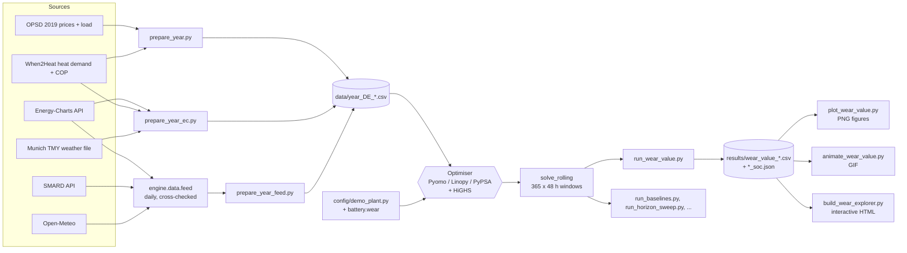

# Branch `feature/pypsa-pyomo`

What this branch adds on top of `main` (commit `bc6cba5`), how the model is
built in Pyomo, Linopy and PyPSA, what goes in, what comes out, and how to
check it on your own machine.

```
main  bc6cba5  Replace reference plant with example site config
  └─ d96fbb0  Add CHP state across windows, start caps, terminal value,
  │           self-consumption baseline, retail tariff
  └─ 6a34a18  Battery wear in dispatch, rainflow scoring, daily data feed
  └─ 339ef03  Linopy port and PyPSA step 1 with parity tests and benchmark
  └─ (next)   wear explorer and animation, this document, README, workflow fix,
              Windows fallback in run_wear_value
```

Tests: 76 on `main` → 134 on this branch (`pytest -q`). The Linopy and PyPSA
tests skip themselves if those packages are not installed.

Contents: [1 Problem](#1-the-problem-hexos-solves) · [2 How it runs](#2-how-it-runs) ·
[3 Data sources](#3-where-the-data-comes-from) · [4 Inputs](#4-inputs) ·
[5 Battery wear](#5-battery-wear-as-modelled) · [6 The tools](#6-the-tools-pyomo-highs-linopy-pypsa) ·
[7 One model, three ways](#7-pyomo-linopy-and-pypsa-one-model-three-ways-to-write-it) ·
[8 Data feed](#8-daily-data-feed) · [9 File-by-file tour](#9-file-by-file-tour) ·
[10 Outputs and how to regenerate them](#10-outputs-and-how-to-regenerate-them) ·
[11 Sharing the explorer with GitHub Pages](#11-sharing-the-explorer-with-github-pages) ·
[12 Changes against main](#12-files-changed-against-main) · [13 Limits](#13-limits-and-next-steps)

---

## 1. The problem HEXOS solves

One industrial site, two energy carriers, one decision every hour:

```
        Grid (buy / sell)      Solar PV          Battery
              │                   │                 │
   ═══════════╪═══════════ ELECTRICITY BUS ═════════╪══════════════ → site load
              │                   │                 │
          CHP engine          Heat pump        Heating rod      (gas / power → heat)
              │                   │                 │
   ═══════════╪═════════════ HEAT BUS ══════════════╪══════════════ → process heat
                                  │
                              Heat store
```

Minimise the site's operating cost over the horizon:

```
  Σ_t [ p_imp(t)·import(t) − p_exp(t)·export(t)
        + p_gas·CHP_gas(t) + fuel prices·boiler fuel(t)
        + start-up cost·starts(t) ] · Δt
  + demand charge · peak import
  + battery wear                       (new, optional)
  − terminal value · battery energy at the end of the window   (optional, decision-only)
```

subject to, every hour:

- electricity balance and heat balance;
- CHP: on/off binary, efficiency, heat-to-power ratio, minimum load, minimum
  run time, ramp limits, start-up flags, optional cap on starts per 24 h,
  optional `on_init` / start history carried from the previous window;
- heat pump `heat = COP(t) · power` (COP is an input series), heating rod,
  woodchip and gas boilers;
- battery and heat store: state-of-charge dynamics with charge/discharge
  efficiency and standing loss, energy and power limits;
- grid import/export limits, peak-import tracking (with a floor carried across
  windows for the demand charge).

A full year is solved as overlapping windows (`solve_rolling`: 48 h window,
24 h committed, ~365 windows). Battery and heat-store levels, CHP on/off, the
last 23 h of start-ups and the running peak are carried from one window to the
next (`engine/solve/state.py`).

## 2. How it runs



Step by step:

1. **Get prices and site profiles.** Either a one-off build from files and
   APIs (`prepare_year.py`, `prepare_year_ec.py`) or the daily feed
   (`python -m engine.data.feed`, then `prepare_year_feed.py`). Each writes one
   hourly year file to `data/`.
2. **Load the site.** `config/demo_plant.py` returns a dict with every unit's
   size and efficiency; scripts switch options on by adding keys (for example
   `cfg["battery"]["wear"] = {...}`).
3. **Optimise.** `engine.load_timeseries` reads the year file;
   `engine.solve_rolling` cuts it into 48 h windows, builds each window's model
   (Pyomo by default, Linopy with `backend="linopy"`), solves it with HiGHS,
   keeps the first 24 h and carries the state into the next window.
4. **Experiment.** A scenario script runs several configurations on the same
   year (for example no battery, wear-blind, wear-aware) and writes the
   comparison to `results/`.
5. **Show.** Plot, animation and explorer scripts read only those `results/`
   files, so figures can be remade without solving again.

## 3. Where the data comes from

| data | source and link | licence | used by |
|---|---|---|---|
| German day-ahead price and load, 2019 | Open Power System Data, time series package (2020-10-06): <https://data.open-power-system-data.org/time_series/> | open (per original source) | `prepare_year.py` |
| heat-demand profiles and heat-pump COP | When2Heat (2023-07-27), Ruhnau et al. 2019: <https://data.open-power-system-data.org/when2heat/> | CC BY 4.0 | `prepare_year.py`, `prepare_year_ec.py` |
| DE-LU day-ahead price, any recent year | Fraunhofer ISE Energy-Charts API: <https://api.energy-charts.info/> (`/price?bzn=DE-LU&start=…&end=…`) | CC BY 4.0 | `prepare_year_ec.py`, `engine/data/feed.py` |
| DE-LU day-ahead price, second source | Bundesnetzagentur SMARD: <https://www.smard.de/> (`/app/chart_data/4169/DE-LU/…`, filter 4169 = day-ahead price) | CC BY 4.0 | `engine/data/feed.py` |
| Munich temperature and solar radiation | Open-Meteo: <https://open-meteo.com/> (historical archive and forecast APIs) | CC BY 4.0 | `engine/data/feed.py` |
| Munich typical-year weather (PV, temperature) | EnergyPlus / IWEC weather file `data/weather/DEU_Munich_108660_IWEC.mos`: <https://energyplus.net/weather> | public | `engine/data/weather.py` |

Raw downloads go in `data/raw/` (see `data/raw/README_DOWNLOAD.md`); year files
and the feed are ignored by git, so the repository holds code only.

## 4. Inputs

### Year file (`data/year_DE_<year>[_retail].csv`)

Hourly rows, header lines starting with `#` say where each column came from.

| column      | unit    | meaning |
|-------------|---------|---------|
| `t`         | –       | hour index 0..n−1, no gaps |
| `price_el`  | EUR/kWh | what the site pays to import |
| `price_exp` | EUR/kWh | what it is paid to export |
| `pv_avail`  | kW      | solar the PV could produce this hour (curtailable) |
| `dem_el`    | kW      | site electricity demand |
| `dem_heat`  | kW      | site heat demand |
| `cop`       | –       | heat-pump coefficient of performance this hour |

Available year files and how they are built:

| file | prices | tariff | built by |
|------|--------|--------|----------|
| `year_DE_2019.csv` | OPSD 2019 | retail (+0.12 EUR/kWh import, export at wholesale) | `prepare_year.py` |
| `year_DE_2024.csv` | Energy-Charts 2024 | spot-linked (±0.015 EUR/kWh) | `prepare_year_ec.py --export-mode spot` |
| `year_DE_2024_retail.csv` | same wholesale as above | retail | `derive_tariff_variant.py` |
| `year_DE_2025.csv` | data feed (Energy-Charts, SMARD fallback) | spot-linked | `prepare_year_feed.py --year 2025` |

The site profiles (heat, COP, load shape, PV) for 2024 and 2025 come from
When2Heat 2022 and the Munich TMY weather file, substituted because When2Heat
does not publish those years. Every file's header says so.

### Site configuration (`config/demo_plant.py`)

A fictional, realistic mid-sized site: 400 kWh / 200 kW battery, 200 kW-el CHP
(η_el 0.40, heat-to-power 1.5, min load 40 %), 400 kW heat pump, 300 kW heating
rod, 1,500 kWh / 400 kW heat store, 1,200 kW grid connection, gas at
0.07 EUR/kWh. All keys are plain Python dicts; anything absent is switched off.

### Battery wear (new, optional): `cfg["battery"]["wear"]`

| key | default | meaning |
|-----|---------|---------|
| `model` | `"throughput"` | `"throughput"` or `"cycle_depth"` |
| `capex_eur_per_kwh` | required | value of the cells being worn out |
| `cycle_life_efc` | required | equivalent full cycles to end of life at 100 % depth |
| `dod_exponent` | 1.5 | b in Φ(d) = d^b / N (cycle_depth only) |
| `segments` | 5 | number of SoC segments J (cycle_depth only) |

## 5. Battery wear, as modelled

`src/engine/technologies/wear.py` adds the cost inside the optimiser:

- **throughput**: every kWh charged or discharged costs
  `capex / (2 · cycle_life)`. One full cycle costs one cycle's share of the cells.
- **cycle depth** (Xu, Oudalov, Ulbig, Andersson & Kirschen, 2018): the battery
  is split into J equal energy segments; energy discharged from segment j costs
  `capex · J · (Φ(j/J) − Φ((j−1)/J)) / η_dis`. Costs rise with depth, so the LP
  uses the shallow segments first without binaries. Still a pure LP.

`src/engine/postprocess/wear.py` scores any schedule afterwards with one
yardstick for every case: rainflow-count the SoC trace (ASTM E1049; checked
against the `rainflow` package on 2,000 random series), apply the same Φ(d),
add calendar ageing (default 15-year calendar life), and turn it into EUR of
cells used and years to end of life.

The parameters are illustrative (LFP-like orders of magnitude), not fitted to a
cell. A fitted degradation model plugs in at exactly these two places.

## 6. The tools: Pyomo, HiGHS, Linopy, PyPSA

- **[Pyomo](https://www.pyomo.org)** is a general Python modelling language
  for optimisation (Sandia National Laboratories). You declare sets,
  parameters, variables and constraints as Python objects, usually with rule
  functions such as "for every hour t, sources = sinks". It is solver-neutral
  and very flexible, which is why HEXOS started there. Its cost is that every
  single variable and constraint is a Python object, so very large models take
  time and memory to build.
- **[HiGHS](https://highs.dev)** is the open-source solver (University of
  Edinburgh) that does the actual optimisation for all three layers: simplex
  and interior point for LPs, branch-and-bound for the MILP (the CHP on/off
  binaries). HEXOS calls it in memory through `highspy`. Its default 1e-4
  relative MIP gap is why the parity tests compare to that tolerance.
- **[Linopy](https://github.com/PyPSA/linopy)** (Hofmann, 2023) is a lighter
  modelling layer built on xarray. A variable is one labelled array over its
  dimensions (here time, CHP unit, wear segment), and a constraint is one
  array expression, so building a big model is vectorised rather than looped.
  Time coupling such as "SoC now depends on SoC an hour ago" is written with
  `.shift(T=1)`. It is the engine underneath PyPSA.
- **[PyPSA](https://pypsa.org)** (Python for Power System Analysis, Brown et
  al., 2018) sits one level higher: you describe a network of standard
  components (buses, generators, loads, links, storage units) and PyPSA writes
  the Linopy model itself. It is the de facto open standard for energy-system
  models (PyPSA-Eur and others), exports networks as CSV/netCDF, and has a
  browser port (PSA.js). Anything outside its components goes in through
  `extra_functionality`, where you add Linopy variables and constraints by hand.
- Supporting libraries: **pandas** (tables, time series), **xarray** (Linopy's
  labelled arrays), **matplotlib** (figures, GIF via Pillow), **LightGBM**
  (price forecasts), **pytest** (tests), **GitHub Actions** (CI and the daily
  feed).

## 7. Pyomo, Linopy and PyPSA: one model, three ways to write it

| | Pyomo (`src/engine`, the original) | Linopy (`src/hexos_linopy/model.py`) | PyPSA (`src/hexos_linopy/pypsa_site.py`) |
|---|---|---|---|
| how a model is built | one Python object per variable and constraint, created by rule functions in a loop over hours | one labelled n-dimensional array per variable (dims: time, CHP unit, wear segment); constraints are array expressions; time coupling via `.shift()` | components (buses, generators, links, storage units, loads); PyPSA writes the Linopy model for you |
| hand-off to HiGHS | `appsi_highs` (in memory) | `io_api="direct"` (in memory) | via Linopy |
| what you write | constraints | constraints | a network; custom constraints only through `extra_functionality` |
| best at | many small models (low set-up cost) | one big model (fast, less memory) | standard, shareable networks (CSV/netCDF export, PyPSA ecosystem, PSA.js in the browser) |
| entry point | `build_model`, `solve`, `extract_results` | `build_linopy`, `solve_linopy`, `extract_linopy`, `run_linopy` | `build_network`, `solve_network`, `extract_network`, `run_pypsa` |
| rolling year | `solve_rolling(data, cfg)` | `solve_rolling(data, cfg, backend="linopy")` | not yet |

How the site maps onto PyPSA components:

| HEXOS | PyPSA |
|-------|-------|
| electricity, heat, CHP gas, boiler fuels | `Bus` "el", "heat", "gas", "wood", "gas_b" |
| grid import | `Generator`, marginal cost = import price |
| grid export | `Generator` with p ∈ [−export_max, 0], marginal cost = export price (negative p is revenue) |
| PV | `Generator`, `p_max_pu` = availability |
| CHP unit | multi-port `Link` gas → el (η_el) and → heat (bus2), `committable=True`, `p_min_pu`, `min_up_time`, `start_up_cost`, `up_time_before` |
| heat pump | `Link` el → heat with time-varying `efficiency` = COP and `p_max_pu` so heat ≤ q_max |
| heating rod, woodchip and gas boilers | `Link` |
| battery, heat store | `StorageUnit` (`efficiency_store`, `efficiency_dispatch`, `standing_loss`) |
| demand charge | `extra_functionality`: a peak variable ≥ import, added to the objective |

Feature coverage:

| feature | Pyomo | Linopy | PyPSA step 1 |
|---|:-:|:-:|:-:|
| grid limits, PV, battery, heat store, heat pump, rod, boilers | ✓ | ✓ | ✓ |
| CHP min load, min run time, start-up cost, `on_init` | ✓ | ✓ | ✓ |
| CHP ramp limits | ✓ | ✓ | not yet |
| CHP max starts per 24 h, start history | ✓ | ✓ | not yet |
| demand charge, peak floor | ✓ | ✓ | ✓ (charge) |
| battery terminal value, fixed schedules, cyclic storage | ✓ | ✓ | not yet |
| battery wear (both models) | ✓ | ✓ | not yet |
| EV sessions | ✓ (single solve) | not yet | not yet |

`pypsa_site` raises `NotImplementedError` for anything it does not cover,
instead of silently solving a different problem.

**Parity.** `tests/test_linopy_parity.py` builds the same configuration in
each layer and checks the optimum agrees, technology by technology (full
site, non-cyclic, battery only, every CHP option, multi-CHP, boilers and heat
dump, demand charge with peak floor and terminal value, fixed schedules, both
wear models, the rolling solver, a real 2024 week). Tolerance is HiGHS's
default MIP gap (1e-4 relative): the models are equivalent but not identical
MILPs, so the branch-and-bound can stop at a different point inside the gap.

**Speed** (`scenarios/bench_backends.py`, demo plant, 2024 prices, each run in
a fresh process):

| | Pyomo | Linopy | PyPSA |
|---|---:|---:|---:|
| one 8,760 h model, build + solve (cloud, 2 CPU) | 20.2 s | 4.5 s | 7.8 s |
| same, Karthik's laptop | 45.9 s | 10.6 s | 13.7 s |
| peak memory, 8,760 h model (laptop) | 1,052 MB | 639 MB | 804 MB |
| rolling year, 365 × 48 h windows (cloud) | 31 s | 291 s | – |
| same, laptop | 61 s | 445 s | – |

Linopy pays a fixed set-up cost of roughly 0.6–1.5 s per model (xarray
bookkeeping), so it wins on one large model and loses on many small ones. The
next step is to build the window model once and only update its data each
window.

## 8. Daily data feed

`src/engine/data/feed.py`, run as `python -m engine.data.feed`:

| source | what | licence |
|---|---|---|
| Energy-Charts (Fraunhofer ISE) | DE-LU day-ahead price | CC BY 4.0 |
| SMARD (Bundesnetzagentur) | DE-LU day-ahead price, second source for the cross-check | CC BY 4.0 |
| Open-Meteo | Munich temperature and shortwave radiation | CC BY 4.0 |

Parameters:

| flag | default | meaning |
|---|---|---|
| `--since YYYY-MM-DD` | two days before the last stored hour (1 Jan of this year if the store is empty) | first day to (re)fetch |
| `--until YYYY-MM-DD` | tomorrow (day-ahead results are out ~12:45 CET) | last day to fetch |
| `--check` | off | print rows, gaps and the Energy-Charts vs SMARD difference; fetch nothing |
| `--max-diff` | 5.0 EUR/MWh | fail if the two price sources disagree by more |

Outputs in `data/feed/` (ignored by git on code branches):
`de_lu_day_ahead.csv` (hourly; columns `energy_charts`, `smard`,
`price_eur_mwh`), `de_lu_day_ahead_15min.csv` (as published; 15-minute since
1 Oct 2025) and `munich_weather.csv`.

`.github/workflows/data_feed.yml` runs it every day at 13:30 UTC and commits
the CSVs to a separate `data-feed` branch, so `main` stays code-only. GitHub
only runs scheduled workflows from the default branch, so the schedule starts
once this branch is merged into `main`; it can then also be started by hand
(Actions → Data feed → Run workflow, optional `since` to backfill). The
repository needs Settings → Actions → General → Workflow permissions set to
"Read and write".

`scenarios/prepare_year_feed.py --year 2025` turns the feed into a year file,
copying the site profiles hour-of-year from `year_DE_2024.csv` so that only the
prices change.

**What the cross-check found.** `year_DE_2024.csv` lacks one hour
(2024-10-29 01:00 UTC): When2Heat 2022 drops an hour at its daylight-saving
switch, the old inner join in `prepare_year_ec.py` dropped the matching price
hour, and the `t` column renumbered the rows, so the last ~9 weeks of 2024
prices sit one hour early. `prepare_year_ec.py` now aligns hours without
dropping any. Rebuild the 2024 files with it to remove the shift (small effect
on results).

## 9. File-by-file tour

### `src/engine/` — the Pyomo model and everything around it

| file | what it does |
|---|---|
| `__init__.py` | re-exports the main entry points: `load_timeseries`, `make_data`, `build_model`, `solve`, `solve_rolling`, `extract_results` |
| `model/core.py` | declares the sets (hours, CHP units, EVs), the time-series parameters and every decision variable |
| `model/build.py` | assembles a model: core, then each technology whose size is above zero, then the objective; `_disabled()` decides what is switched off |
| `model/objective.py` | total operating cost: energy, export revenue, gas and boiler fuel, start-ups, demand charge, optional terminal value, optional wear |
| `technologies/balances.py` | the electricity and heat balance every hour; peak-import tracking with a carried floor |
| `technologies/grid.py` | import and export limits |
| `technologies/pv.py` | PV can be used up to what is available (curtailable) |
| `technologies/battery.py` | state-of-charge dynamics, power and energy limits, optional fixed schedule, hook for wear |
| `technologies/wear.py` | **new**: throughput and cycle-depth wear costs, segment variables and constraints |
| `technologies/chp.py` | CHP units: efficiency, heat-to-power ratio, on/off binary, min load, min run time, ramps, start-ups, start caps |
| `technologies/heatpump.py`, `rod.py`, `boiler.py` | power→heat with COP(t), resistive heating, woodchip and gas boilers |
| `technologies/heat_storage.py` | hot-water store dynamics and limits |
| `technologies/ev.py` | EV charging sessions with energy-by-deadline (single solves only) |
| `technologies/curtail.py` | heat dump off unless allowed; locks for switched-off units |
| `solve/single.py` | solve one Pyomo model with HiGHS (`appsi_highs`) |
| `solve/rolling.py` | the rolling-horizon year solve; `backend="pyomo"` or `"linopy"` |
| `solve/state.py` | what carries from one window to the next: storage levels, CHP on/off, start log, peak |
| `postprocess/extract.py` | turn a solved Pyomo model into plain lists (`import`, `soc`, `chp_el`, …) |
| `postprocess/wear.py` | **new**: rainflow counting and the common wear yardstick |
| `postprocess/cop_variants.py` | COP series for the heat-pump fidelity study |
| `control/mpc.py` | closed-loop model-predictive control simulation with a forecaster |
| `control/forecasters.py`, `simulator.py` | perfect and noisy forecasts; applies decisions to the "real" plant |
| `control/rules.py` | the battery's built-in self-consumption rule, as a baseline |
| `data/io.py` | read and validate a year file; fail loudly on gaps, NaNs, negative demand |
| `data/weather.py` | read the Munich `.mos` weather file; PV, COP and heat-demand shapes from it |
| `data/daytypes.py` | pick real representative days (sunny, cloudy, cold snap) for the dashboard |
| `data/feed.py` | **new**: the daily data feed (Energy-Charts, SMARD, Open-Meteo) |
| `forecast/baseline.py` | persistence and type-day forecasts |
| `market/bidding.py` | day-ahead bid curves from parametric solves, made monotone (PAVA) |

### `src/hexos_linopy/` — the same model in Linopy and PyPSA (new)

| file | what it does |
|---|---|
| `__init__.py` | exports `build_linopy`, `solve_linopy`, `extract_linopy`, `run_linopy` |
| `model.py` | the full site model as Linopy arrays, including both wear models; returns results in the same format as `extract_results`, so the rolling solver and all scripts work unchanged |
| `pypsa_site.py` | step 1: the site as a `pypsa.Network` (`build_network`, `solve_network`, `extract_network`, `run_pypsa`); raises for features it does not cover yet |

### `config/`, `app/`, `.github/`

| file | what it does |
|---|---|
| `config/demo_plant.py` | the fictional example site, and a small EV fleet for the EV demo |
| `app/streamlit_app.py`, `app/db.py` | the interactive Streamlit dashboard and its optional PostgreSQL store |
| `.github/workflows/ci.yml` | runs the test suite on every push |
| `.github/workflows/data_feed.yml` | **new**: the daily data feed |

### `scenarios/` — the experiments (each has a docstring with its run commands)

| file | question it answers / what it makes |
|---|---|
| `prepare_year.py`, `prepare_weather_year.py` | build the 2019 year files from OPSD / When2Heat / Munich weather |
| `prepare_year_ec.py` | build a year file from Energy-Charts prices (alignment fix on this branch) |
| `derive_tariff_variant.py` | retail-tariff copy of a spot-linked year file |
| `prepare_year_feed.py` | **new**: year file from the data feed |
| `run_year.py` | one full-year rolling solve |
| `run_flex_value.py` | battery on vs off, everything else equal |
| `run_baselines.py` | no battery vs self-consumption rule vs optimised; options for demand charge, CHP start costs, payback |
| `run_wear_value.py` | **new**: wear-blind vs wear-aware dispatch, scored by one wear yardstick, over a cell-value sweep |
| `run_mpc.py`, `run_horizon_sweep.py`, `key_hours.py` | MPC with forecasts; 24 h vs 48 h horizon by season; the numbers behind the figure |
| `forecast_prices.py`, `run_bidding.py` | probabilistic price forecasts; day-ahead bid curves |
| `compare_cop.py`, `run_ev_day.py` | heat-pump COP fidelity; EV smart-charging day |
| `bench_backends.py` | **new**: Pyomo vs Linopy vs PyPSA speed and memory |
| `plot_*.py`, `animate_dispatch.py` | figures and videos for each experiment |
| `plot_wear_value.py` | **new**: wear summary, cell-value sweep, one-week SoC figures |
| `animate_wear_value.py` | **new**: the looping GIF (see section 10) |
| `build_wear_explorer.py`, `explorer_template.html` | **new**: the interactive explorer page (see section 10) |
| `plot_bench_backends.py` | **new**: the speed chart |

### `tests/`

| file | covers |
|---|---|
| `test_electricity.py`, `test_heat.py`, `test_gas_boiler.py`, `test_multichp.py`, `test_startup_demand.py`, `test_ev.py` | hand-checkable cases for each technology |
| `test_rolling.py`, `test_mpc.py`, `test_stochastic_forecast.py` | seams between windows, MPC against perfect foresight, forecast noise |
| `test_bidding.py`, `test_forecast.py`, `test_cop_variants.py`, `test_daytypes.py` | bidding, forecasting and data helpers |
| `test_comment_features.py` | CHP state and start caps, terminal value, peak carry, self-consumption rule |
| `test_wear.py` | **new**: both wear models and the rainflow evaluator |
| `test_linopy_parity.py` | **new**: Linopy and PyPSA reach the Pyomo optimum, feature by feature |
| `test_feed.py` | **new**: data-feed parsers, merge, gaps and cross-check, offline |

## 10. Outputs and how to regenerate them

| script | writes | what to look for |
|---|---|---|
| `pytest -q` | – | 134 passed |
| `run_wear_value.py --data 2024 --capex 100,200,300` | `results/wear_value_DE_2024.csv`, `..._soc.json` | at 200: wear-blind net ≈ 7,751; cycle-depth ≈ 9,898; 690 → ~373 cycles/yr |
| `run_wear_value.py --data 2019 ...` | `results/wear_value_DE_2019.csv` | at 200: wear-blind net ≈ −1,038; cycle-depth ≈ 2,342 |
| `run_wear_value.py --data 2025 ...` | `results/wear_value_DE_2025.csv` | at 200: wear-blind net ≈ 9,829; cycle-depth ≈ 11,708 |
| `plot_wear_value.py --tags DE_2019,DE_2024,DE_2025` | `results/wear_value_summary.png`, `_sweep.png`, `_week.png` | |
| `build_wear_explorer.py` | `results/wear_explorer.html` (one self-contained page) | run every year with the same `--capex` list first |
| `animate_wear_value.py --tags DE_2019,DE_2024` | `results/wear_value_anim.gif` (1200 × 1200) | |
| `bench_backends.py --data 2024` | `results/bench_backends_2024.csv` | objectives agree to ~1e-4 |
| `plot_bench_backends.py --data 2024` | `results/bench_backends_2024.png` | |
| `python -m engine.data.feed` | `data/feed/*.csv` | `price_gaps: []`, small `max_abs_diff` |
| `prepare_year_feed.py --year 2025` | `data/year_DE_2025.csv` | 8,759 h, mean ≈ 89.3 EUR/MWh, 576 negative hours |

### Regenerate every wear output, in order

Each step reads only what the step before wrote. Use the same `--capex` list
for every year, because the explorer and the sweep figure compare years at the
same cell values.

```powershell
$env:PYTHONPATH = "src"
$CAPEX = "50,100,150,200,250,300,350,400"
foreach ($y in "2019", "2024", "DE_2024_retail", "2025") {
    python scenarios/run_wear_value.py --data $y --capex $CAPEX        # add --workers 1 if a worker crashes
}
python scenarios/plot_wear_value.py --tags DE_2019,DE_2024,DE_2025    # PNGs
python scenarios/animate_wear_value.py --tags DE_2019,DE_2024         # GIF
python scenarios/build_wear_explorer.py                               # interactive HTML
```

Each `run_wear_value.py` call solves 18 full years (no battery, wear-blind, and
two wear-aware models at 8 cell values): about 8 minutes per year on the
2-CPU cloud machine, roughly 10–20 minutes on a laptop.

**How the GIF is made.** `animate_wear_value.py` reads only
`results/wear_value_<tag>.csv`. For each frame it picks a cell value between
the lowest and highest one in the CSV, interpolates gross and net value for
each dispatch strategy at that cell value, and draws the bars with
matplotlib. `FuncAnimation` sweeps the cell value up and back down
(4 s each way, 1 s hold at each end, 12 frames per second) and `PillowWriter`
saves a 1200 × 1200 GIF. Change `--tags` for other years, `--fps` for speed,
`--out` for the file name.

**How the explorer is made.** `build_wear_explorer.py` reads, for each year,
`results/wear_value_<tag>.csv` (the numbers for every case and cell value),
`results/wear_value_<tag>_soc.json` (the hourly battery charge for wear-blind
and cycle-depth dispatch at every cell value) and the year file (for the
price). It packs them into compact JSON (charge as whole percent, price in
whole EUR/MWh), puts that into `scenarios/explorer_template.html`, and writes
one file, `results/wear_explorer.html` (about 0.5 MB), with no server and
nothing else needed. It works offline except for the web fonts.

`run_wear_value.py` solves its cases in two worker processes. If a worker
dies (on Windows this shows up as `BrokenProcessPool`), it now finishes the
remaining cases one by one instead of failing; `--workers 1` runs everything
in one process, which also shows the real error if a solver crashes.

Columns of `wear_value_*.csv`: `dataset`, `capex_eur_per_kwh`, `case`
(B wear-blind / C throughput / D cycle-depth), `gross_saving_eur` (vs no
battery, energy only), `cycle_wear_eur`, `calendar_wear_eur`,
`net_value_eur` (gross − cycle wear), `efc_per_year`, `mean_cycle_depth`,
`years_to_eol` (cycle + calendar), `solve_s`.

## 11. Sharing the explorer with GitHub Pages

GitHub Pages serves static files from a repository as a public website, free,
at `https://<user>.github.io/<repo>/`. For HEXOS that means a permanent public
link to the explorer that anyone can open without an account, that you can put
in a LinkedIn post, a CV or a README, and that updates when you push.

```powershell
python scenarios/build_wear_explorer.py --out docs/explorer/index.html
git add docs/explorer/index.html
git commit -m "Publish the wear explorer"
git push
```

Then on GitHub: Settings → Pages → Build and deployment → Source "Deploy from a
branch", branch `feature/pypsa-pyomo` (or `main` after merging), folder
`/docs`. After a minute the page is at
`https://kartgithub6.github.io/hexos-energy-optimization/explorer/`.
Everything in `docs/` becomes public, including this file, which is fine
because the repository is public already.

## 12. Files changed against `main`

Commit 1, comment ideas: `engine/solve/state.py` (state carried across
windows), `engine/control/rules.py` (self-consumption rule), CHP `on_init`,
`max_starts_per_day`, `su_hist`; battery `fixed_ch`/`fixed_dis`; objective
terminal value; `peak_so_far`; `run_baselines.py`, `derive_tariff_variant.py`,
`plot_border_effect.py`, `plot_comment_summary.py`, `--terminal-value` in
`run_horizon_sweep.py`, `--suffix` in `prepare_year_ec.py`;
`tests/test_comment_features.py`.

Commit 2, battery wear and data feed: `engine/technologies/wear.py`,
`engine/postprocess/wear.py`, hooks in `battery.py` and `objective.py`;
`run_wear_value.py`, `plot_wear_value.py`; `engine/data/feed.py`,
`prepare_year_feed.py`, `.github/workflows/data_feed.yml`; the alignment fix
in `prepare_year_ec.py`; `tests/test_wear.py`, `tests/test_feed.py`.

Commit 3, Linopy and PyPSA: `src/hexos_linopy/` (`model.py`, `pypsa_site.py`),
`backend=` switch in `engine/solve/rolling.py`; `bench_backends.py`,
`plot_bench_backends.py`; `tests/test_linopy_parity.py`; README; optional
`pypsa` extra in `pyproject.toml`.

## 13. Limits and next steps

- PyPSA step 2: ramps, start caps, wear and terminal value as custom constraints.
- Linopy rolling: build once, update data per window.
- A fitted degradation model (temperature, C-rate, calendar, SoC) in place of
  the illustrative Φ(d).
- 15-minute day-ahead products, intraday and balancing markets.
- Rebuild `year_DE_2024*.csv` with the fixed alignment.
- Minimum run time is enforced within a window, not across seams.

## References

- Xu, B., Oudalov, A., Ulbig, A., Andersson, G., Kirschen, D. S. (2018).
  Modeling of lithium-ion battery degradation for cell life assessment. IEEE
  Transactions on Smart Grid 9(2), 1131–1140.
- Hofmann, F. (2023). Linopy: Linear optimization with n-dimensional labeled
  variables. Journal of Open Source Software 8(84), 4823. doi:10.21105/joss.04823
- Brown, T., Hörsch, J., Schlachtberger, D. (2018). PyPSA: Python for Power
  System Analysis. Journal of Open Research Software 6(1).
- Ruhnau, O., Hirth, L., Praktiknjo, A. (2019). Time series of heat demand and
  heat pump efficiency for energy system modeling. Scientific Data 6, 189.
- Bynum, M. L. et al. (2021). Pyomo — Optimization Modeling in Python, 3rd ed. Springer.
- Huangfu, Q., Hall, J. A. J. (2018). Parallelizing the dual revised simplex
  method. Mathematical Programming Computation 10, 119–142 (HiGHS).
